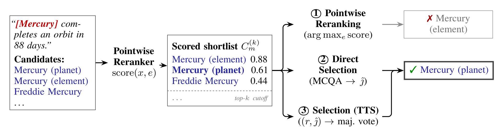

<div align="center">

# When Does Reasoning Help Entity Disambiguation?<br>Small LLMs In-Domain and Under Shift

[Samy Haffoudhi](https://samyhaff.github.io/), [Fabian M. Suchanek](https://suchanek.name/), [Nils Holzenberger](https://perso.telecom-paristech.fr/holzenberger/)<br>
Télécom Paris, Institut Polytechnique de Paris

[](https://arxiv.org/abs/2611.30334)
[](https://arxiv.org/abs/2611.30334)
[](https://hf.co/collections/samyhaff/ed-study)
[](https://www.python.org/)
[](https://github.com/astral-sh/uv)
[](LICENSE)

</div>

<p align="center"></p>

We compare three candidate-selection paradigms for entity disambiguation with small LLMs (0.6–4B): **pointwise reranking**, **direct selection** from a shortlist, and **reasoning** with self-consistency, trained by distillation or RL (GRPO). We evaluate them in the classical, few-shot and true zero-shot settings.

**The benefit of reasoning grows with domain shift: it is negligible in-domain and decisive in the true zero-shot setting.**

| 4B models | Classical<br><sub>ZELDA, acc.</sub> | Few-shot<br><sub>ZESHEL, norm. acc.</sub> | True zero-shot<br><sub>ZESHEL, norm. acc.</sub> |
|:--|:-:|:-:|:-:|
| Pointwise reranking | **81.0** | 83.8 | 77.6 |
| Direct selection | 79.5 | 81.8 | 77.3 |
| Reasoning | 80.5 <sub>RLVR</sub> | **85.9** <sub>distill → RLVR</sub> | **83.7** <sub>off-policy distill</sub> |

- **Uncertainty locates disagreement.** Reranking and reasoning mostly disagree on mentions where the reranker's top-2 margin is small, and such mentions become more frequent under shift. Under true zero-shot shift, reasoning repairs three times as many reranker predictions as it breaks.
- **The best training recipe depends on the setting.** Off-policy distillation transfers best under shift. With a little in-domain data, RLVR is the only recipe that beats the 26B teacher, but it also forgets more of the source domain.
- **Gains concentrate on lexical ambiguity.** Reasoning helps most when the mention matches several entity titles that differ only by a disambiguation phrase.

## Setup

```bash
uv sync
```

Data goes in `data/zelda` ([ZELDA](https://github.com/flairNLP/zelda)), `data/zeshel` ([ZESHEL](https://github.com/lajanugen/zeshel)) and `data/gladis` ([GLADIS](https://github.com/tigerchen52/gladis)).

The teacher model is served with:

```bash
uv run trl vllm-serve --model google/gemma-4-26B-A4B-it --port 8000 --max_model_len 8192 --tensor_parallel_size 2 --gpu_memory_utilization 0.65
```

## Inference

Listwise paradigms rerank the top-10 shortlist produced by the pointwise reranker (`--shortlist`).

```bash
# ZELDA
uv run annotate_zelda.py data/zelda test_aida-b out/aida_reranker.jsonl --model <reranker> --reranker
uv run annotate_zelda.py data/zelda test_aida-b out/aida_direct.jsonl --model <direct-selector> --direct --shortlist out/aida_reranker.jsonl --max_model_len 32768
uv run annotate_zelda.py data/zelda test_aida-b out/aida_tts.jsonl --model <reasoner> --n 10 --shortlist out/aida_reranker.jsonl

# ZESHEL, GLADIS
uv run annotate_zeshel.py data/zeshel test out/lego_tts.jsonl --domains lego --model <reasoner> --n 10 --shortlist out/lego_reranker.jsonl --context_window 3072
uv run annotate_gladis.py data/gladis biomedical out/gladis_tts.jsonl --model <reasoner> --n 10 --shortlist out/gladis_reranker.jsonl --context_window 3072
```

```bash
uv run evaluate.py zelda out/aida_tts.jsonl --sc
uv run evaluate.py zeshel out/lego_tts.jsonl
uv run evaluate.py zeshel out/lego_reranker.jsonl --top_k 10
uv run evaluate.py zeshel out/lego_fewshot.jsonl --exclude_train_data data/fewshot/lego_direct.jsonl
uv run evaluate.py gladis out/gladis_tts.jsonl
```

## Training

<details>
<summary><b>Classical setting (ZELDA)</b></summary>

<br>

```bash
uv run prepare_zelda.py data/zelda
uv run annotate_zelda.py data/zelda train out/train_reranker.jsonl --model tomaarsen/Qwen3-Reranker-4B-seq-cls --reranker
```

```bash
# Pointwise reranker
uv run build_zelda_data.py reranker data/zelda data/reranker.jsonl --shortlist out/train_reranker.jsonl
uv run train_reranker.py data/reranker.jsonl models/reranker-4b --model tomaarsen/Qwen3-Reranker-4B-seq-cls --quantize

# Direct selection (lr 1e-4 for 0.6B, 1e-5 otherwise)
uv run build_zelda_data.py direct data/zelda data/direct.jsonl --shortlist out/train_reranker.jsonl
uv run train_sft.py data/direct.jsonl models/direct-4b --model Qwen/Qwen3-4B --quantize

# Off-policy distillation (λ=0, β=0)
uv run annotate_zelda.py data/zelda train out/train_teacher.jsonl --model google/gemma-4-26B-A4B-it --n 10 --shortlist out/train_reranker.jsonl --shuffle
uv run build_zelda_data.py distill data/zelda data/distill.jsonl --predictions out/train_teacher.jsonl
uv run train_gkd.py data/distill.jsonl models/e4b-off http://localhost:8000 --student google/gemma-4-E4B-it
uv run train_sft.py data/distill.jsonl models/qwen-0.6b-off --model Qwen/Qwen3-0.6B --learning_rate 1e-4

# On-policy distillation (λ=1, β=1)
uv run train_gkd.py data/distill.jsonl models/e4b-on http://localhost:8000 --student google/gemma-4-E4B-it --lmbda 1 --beta 1

# RLVR (GRPO)
uv run annotate_zelda.py data/zelda train out/train_student.jsonl --model Qwen/Qwen3-4B --n 10 --shortlist out/train_reranker.jsonl --shuffle
uv run build_zelda_data.py grpo data/zelda data/grpo.jsonl --shortlist out/train_reranker.jsonl --predictions out/train_student.jsonl
uv run accelerate launch train_grpo.py data/grpo.jsonl models/qwen-4b-grpo --model Qwen/Qwen3-4B
```

Merge LoRA adapters before inference:

```bash
uv run merge_lora.py models/e4b-off/checkpoint-2700 models/e4b-off/model
```

</details>

<details>
<summary><b>Few-shot setting (ZESHEL)</b></summary>

<br>

Per test domain, 100 mentions are sampled for training (10 held out for validation); the rest are used for evaluation.

```bash
uv run annotate_zeshel.py data/zeshel test out/lego_base_reranker.jsonl --domains lego --model tomaarsen/Qwen3-Reranker-4B-seq-cls --reranker
uv run build_zeshel_data.py reranker data/zeshel lego data/fewshot/lego_reranker.jsonl --shortlist out/lego_base_reranker.jsonl
uv run build_zeshel_data.py direct data/zeshel lego data/fewshot/lego_direct.jsonl --shortlist out/lego_base_reranker.jsonl
uv run build_zeshel_data.py grpo data/zeshel lego data/fewshot/lego_grpo.jsonl --shortlist out/lego_base_reranker.jsonl
uv run annotate_zeshel.py data/zeshel test out/lego_teacher.jsonl --domains lego --model google/gemma-4-26B-A4B-it --n 10 --shortlist out/lego_base_reranker.jsonl --context_window 3072 --shuffle
uv run build_zeshel_data.py distill data/zeshel lego data/fewshot/lego_distill.jsonl --predictions out/lego_teacher.jsonl
```

```bash
uv run train_reranker.py data/fewshot/lego_reranker.jsonl models/reranker-4b-lego --model tomaarsen/Qwen3-Reranker-4B-seq-cls --base_adapter models/reranker-4b/checkpoint-9000 --epochs 15 --eval_split 0.1 --save_steps 50 --eval_steps 50 --quantize
uv run train_sft.py data/fewshot/lego_direct.jsonl models/direct-4b-lego --model Qwen/Qwen3-4B --base_adapter models/direct-4b/checkpoint-7500 --epochs 100 --eval_split 0.1 --quantize
uv run train_gkd.py data/fewshot/lego_distill.jsonl models/e4b-off-lego http://localhost:8000 --student models/e4b-off/model --epochs 200 --eval_split 0.1
uv run accelerate launch train_grpo.py data/fewshot/lego_grpo.jsonl models/e4b-grpo-lego --model models/e4b-off/model --epochs 15 --per_device_train_batch_size 2 --eval_split 0.1
```

</details>

## Citation

```bibtex
@inproceedings{haffoudhi2027reasoning,
  title         = {When Does Reasoning Help Entity Disambiguation? Small {LLM}s In-Domain and Under Shift},
  author        = {Haffoudhi, Samy and Suchanek, Fabian M. and Holzenberger, Nils},
  booktitle     = {Findings of the Association for Computational Linguistics: EACL 2027},
  year          = {2027},
  eprint        = {2611.30334},
  archivePrefix = {arXiv}
}
```

## License

[Apache 2.0](LICENSE)
